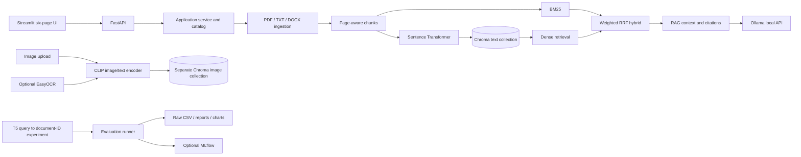

# OmniSearch AI: Technical and Research Report

**Project type:** student-oriented research prototype
**Document revision:** 2026-11-16
**Implementation target:** Python 3.12, Windows 11
**Hardware used in recorded runs:** NVIDIA RTX 3050 Laptop GPU, 4 GiB VRAM; 16 GiB system RAM

## Abstract

OmniSearch AI is a modular research codebase and local application for comparing
keyword, dense, hybrid, generative, and multimodal retrieval, and for grounding
answers with retrieved document evidence. It includes PDF/TXT/DOCX ingestion,
page-aware chunks, optional persistent Chroma vector indexing, a FastAPI service,
a Streamlit interface, and a reusable ranking-evaluation runner. The dense text
baseline is Sentence Transformers `all-MiniLM-L6-v2`; image-text retrieval uses
CLIP ViT-B/32; the experimental query-to-document-ID baseline fine-tunes a small
T5; and the replaceable RAG generation adapter calls local Ollama.

The committed measured comparison is deliberately small: BM25, dense, and RRF
hybrid are tied on four manually judged synthetic queries. A separate committed
embedding smoke benchmark measures a warm eight-text batch. A final reproducible
demo run measures BM25 on a three-query project-authored fixture. There are no
measured generative-retrieval or learned multimodal effectiveness results in the
repository. The tests verify code paths with mocks where model weights or a
local model service would otherwise be required. The recorded numbers are
engineering smoke observations, not benchmark evidence of general performance.

## 1. Problem statement

Users need to find evidence across heterogeneous local documents. Exact lexical
matching can miss paraphrases; semantic ranking can miss exact identifiers;
images need visual and OCR-aware search; generated answers need traceable
evidence. These are related but distinct tasks. OmniSearch AI provides modular
baselines and a shared evaluation interface so researchers can inspect their
assumptions and compare them on judged data instead of assuming that a more
complex method is better.

## 2. Research objectives

1. Build reliable, page-aware ingestion for PDF, TXT, and DOCX sources.
2. Compare BM25 with dense semantic retrieval and rank fusion.
3. Implement a small query-to-document-ID generative retrieval baseline.
4. Support text-to-image and image-to-image search in CLIP's joint space, with
   optional OCR for diagrams and screenshots.
5. Ground local LLM answers in retrieved passages and show source/page citations.
6. Make evaluation reproducible through split-aware qrels, raw result files,
   configuration, seed, software/hardware metadata, and optional MLflow tracking.
7. Keep model downloads and model-backed runs explicit, so CPU and test-only
   workflows remain available on a 4 GiB laptop GPU.

## 3. Literature review

### Lexical retrieval

The probabilistic relevance framework and BM25 provide a strong lexical
baseline whose term-frequency and length-normalization behavior is interpretable.
The implementation uses `rank-bm25` BM25Okapi; it has no learned query or
document encoder. Robertson and Zaragoza's survey gives the theoretical
background for BM25 [1].

### Dense retrieval and embeddings

Sentence-BERT uses siamese/triplet training to produce fixed-size sentence
vectors that can be compared efficiently. Dense Passage Retrieval (DPR) shows a
retrieval architecture based on independently encoded questions and passages
trained for open-domain QA [2, 3]. OmniSearch AI uses a compact off-the-shelf
Sentence Transformer (`all-MiniLM-L6-v2`) rather than training DPR; this is an
engineering baseline and not a reproduction of DPR. BEIR's heterogeneous
evaluation found that lexical baselines can remain competitive out of domain,
which motivates retaining BM25 as an independent baseline [4].

### Rank fusion and ranking evaluation

Reciprocal Rank Fusion (RRF) combines ranked lists without assuming their scores
share a scale. This is appropriate for BM25, cosine similarity, and other
method-specific scores, but does not guarantee the fused ranking wins on a
particular dataset [5]. Precision@K, Recall@K, and MRR report binary relevance
and rank position; normalized DCG can additionally use graded judgments [6].

### Generative retrieval

T5 is a text-to-text encoder-decoder architecture pretrained with a unified
sequence-to-sequence objective [10].
Neural Corpus Indexer (NCI) treats retrieval as sequence generation over
document identifiers and introduces additional architecture and training
techniques to improve recall [7]. This repository's prototype uses T5 with a
sorted list of special-token document IDs, query/document pairs, and ordinary
beam search. It omits NCI's specialized prefix-aware decoder, semantic ID
design, and research-scale training. It is a simplified educational baseline,
not an NCI reproduction.

### Multimodal retrieval

CLIP learns aligned image and text representations from paired natural-language
supervision, enabling text-to-image comparisons in a shared embedding space
[8]. OmniSearch uses the same checkpoint's image and text towers and keeps that
collection separate from Sentence Transformer text vectors. OCR is provided by
EasyOCR as a complementary text-extraction component; OCR output is metadata,
not an embedding-space substitute for CLIP.

### Retrieval-augmented generation

Lewis et al. describe RAG models that combine parametric generation with
retrieved non-parametric memory for knowledge-intensive tasks [9]. OmniSearch's
pipeline is a simpler retrieve-then-generate workflow: it assembles bounded
evidence blocks, asks the local provider to cite them, and returns source/page
references. Citation marker checks are not a proof that every claim is
entailed; users must inspect the quoted sources.

### References

1. Stephen Robertson and Hugo Zaragoza. 2009. “The Probabilistic Relevance
   Framework: BM25 and Beyond.” *Foundations and Trends in Information
   Retrieval*, 3(4), 333–389. [DOI](https://doi.org/10.1561/1500000019).
2. Nils Reimers and Iryna Gurevych. 2019. “Sentence-BERT: Sentence Embeddings
   using Siamese BERT-Networks.” EMNLP-IJCNLP 2019, 3982–3992.
   [ACL Anthology](https://aclanthology.org/D19-1410/).
3. Vladimir Karpukhin et al. 2020. “Dense Passage Retrieval for Open-Domain
   Question Answering.” EMNLP 2020.
   [ACL Anthology](https://aclanthology.org/2020.emnlp-main.550/).
4. Nandan Thakur et al. 2021. “BEIR: A Heterogeneous Benchmark for Zero-shot
   Evaluation of Information Retrieval Models.” NeurIPS 2021 Datasets and
   Benchmarks. [Proceedings](https://datasets-benchmarks-proceedings.neurips.cc/paper/2021/hash/65b9eea6e1cc6bb9f0cd2a47751a186f-Abstract-round2.html).
5. Gordon V. Cormack, Charles L. A. Clarke, and Stefan Büttcher. 2009.
   “Reciprocal Rank Fusion outperforms Condorcet and individual Rank Learning
   Methods.” SIGIR 2009, 758–759.
   [Author PDF](https://cormack.uwaterloo.ca/cormack/cormacksigir09-rrf.pdf).
6. Kalervo Järvelin and Jaana Kekäläinen. 2002. “Cumulated gain-based
   evaluation of IR techniques.” *ACM Transactions on Information Systems*,
   20(4), 422–446. [DOI](https://doi.org/10.1145/582415.582418).
7. Yujing Wang et al. 2022. “A Neural Corpus Indexer for Document Retrieval.”
   NeurIPS 2022. [Proceedings](https://proceedings.neurips.cc/paper_files/paper/2022/hash/a46156bd3579c3b268108ea6aca71d13-Abstract-Conference.html).
8. Alec Radford et al. 2021. “Learning Transferable Visual Models From Natural
   Language Supervision.” ICML 2021, PMLR 139, 8748–8763.
   [Proceedings](https://proceedings.mlr.press/v139/radford21a.html).
9. Patrick Lewis et al. 2020. “Retrieval-Augmented Generation for
   Knowledge-Intensive NLP Tasks.” NeurIPS 2020.
   [Proceedings](https://proceedings.neurips.cc/paper/2020/hash/6b493230205f780e1bc26945df7481e5-Abstract.html).
10. Colin Raffel et al. 2020. “Exploring the Limits of Transfer Learning with
    a Unified Text-to-Text Transformer.” *Journal of Machine Learning Research*,
    21(140), 1–67. [JMLR](https://www.jmlr.org/papers/v21/20-074.html).

## 4. System architecture

The implementation uses a `src/omnisearch_ai/` package and separates reusable
domain components from the HTTP/UI layer.

The backend stores uploaded files/catalog under `data/app/` by default and
Chroma vectors under the configured vector-store directory. BM25 is rebuilt
in memory from catalogued documents at application startup. Model-backed
components are constructed lazily. The application binds to loopback in the
documented launch command; it does not provide authentication and should not be
exposed to an untrusted network as-is.

Detailed package responsibilities are listed in [architecture.md](architecture.md).

## 5. Technology and model selection

| Component | Selected technology | Rationale and current boundary |
|---|---|---|
| Runtime | Python 3.12 | Project package and tests target 3.12. |
| API/UI | FastAPI, Uvicorn, Streamlit | Local HTTP backend and research-oriented UI. |
| PDF/TXT/DOCX | PyMuPDF, UTF-8/CP1252 text decode, python-docx | Page-aware text extraction; DOCX pagination is logical/explicit-break based. |
| Keyword | rank-bm25 BM25Okapi | Independent lexical baseline; in-memory ranking. |
| Text vectors | sentence-transformers/all-MiniLM-L6-v2 | Compact 384-dimensional vectors; L2 normalization and cosine retrieval. [Model card](https://huggingface.co/sentence-transformers/all-MiniLM-L6-v2). |
| Vector store | ChromaDB PersistentClient | Local persistent collections for text and images, stored separately. [Client docs](https://github.com/chroma-core/chroma/blob/main/docs/mintlify/reference/python/client.mdx). |
| Rank fusion | Weighted RRF | Combines rank positions rather than uncalibrated raw scores. |
| Cross-encoder | cross-encoder/ms-marco-MiniLM-L-6-v2 | Optional reranking component; weights load only when enabled. |
| Generative retrieval | google/flan-t5-small | Small T5 encoder-decoder for the experimental document-ID mapping. |
| Image/text | openai/clip-vit-base-patch32 | Shared embedding space for text-to-image and image-to-image retrieval. |
| OCR | EasyOCR | Optional screenshot/diagram text extraction; independent of CLIP vectors. |
| RAG generator | Ollama API, default qwen2.5:3b-instruct-q4_K_M | Replaceable local-provider adapter. Model execution and GPU/CPU placement are not assumed by tests. |
| Evaluation | Project metrics, CSV/JSON/Markdown, optional Matplotlib/MLflow | Makes actual result lists auditable and keeps experiment tracking optional. |

The recorded NVIDIA environment for the committed embedding and hybrid reports
was PyTorch `2.14.1+cu130`, CUDA runtime 13.0, driver 581.83, Python 3.12.5,
and an RTX 3050 Laptop GPU. Those are run-environment records, not claims that
every machine should install the same latest version. AMD integrated graphics
is not used by this CUDA path. Consult [installation.md](installation.md) for
the repository's recorded Windows setup.

## 6. Methodology

### Ingestion and shared representation

- Content-addressed document ID: SHA-256 of normalized extracted text.
- PDF page numbers are physical pages; TXT form-feed splits become logical
  pages; DOCX uses explicit page breaks/page-break-before markers because
  `python-docx` does not render pagination.
- Default chunks are 1,000 Unicode characters with 100 characters of overlap.
  Chunks do not cross a page boundary and carry offsets, page, chunk index, and
  a stable document reference.
- Empty and unreadable documents raise explicit ingestion errors. Scanned
  image-only PDFs are not OCR'd by the text ingestor.

### Retrieval

- BM25 tokenizes case-folded Unicode word sequences and ranks matching chunks.
- Dense retrieval embeds chunks and query text, normalizes vectors, and uses
  Chroma cosine distance. The encoder starts with a conservative CUDA batch and
  reduces it on out-of-memory errors, with CPU fallback.
- Hybrid retrieval independently retrieves BM25 and dense candidates and applies
  configurable weighted RRF. Default RRF `k=60`, candidate depth 20, equal
  weights. Optional cross-encoder scores are applied after fusion.
- Generative retrieval expands judged query/document pairs, splits by query,
  assigns sorted document IDs to fingerprinted special tokens, fine-tunes T5
  with small batches/gradient accumulation/checkpointing, and beam-generates
  candidate ID tokens. Invalid, duplicate, and unmapped candidates are skipped.
- Multimodal retrieval content-hashes images, stores image provenance/OCR fields,
  and uses CLIP's text or image tower to query the distinct image collection.

### RAG

The RAG pipeline receives a searcher and an `LLMProvider`. It bounds context by
chunk count and character count, marks evidence `[S1]` etc., asks Ollama to use
only evidence, validates that a returned marker exists, and includes document
name/page citations. Empty retrieval and invalid citations produce an explicit
insufficient-evidence answer. This is citation checking, not semantic entailment
verification or a guarantee against hallucination.

### Evaluation protocol

Evaluation requires query IDs, a held-out split, explicit qrels, and a local
dataset manifest containing name/version, license, source, and citation.
Precision@K uses K as denominator; Recall@K divides by the number of positive
judgments; MRR uses the first positive result; nDCG uses graded gain
`2**grade - 1`. Duplicate result IDs are deduplicated. Macro means are computed
across judged queries. Search latency is the median of timed calls per query,
then averaged across query medians; warm-up, model startup, and index creation
are excluded. Query embedding time is separately timed only when a probe is
provided. A run records raw retrieved results in CSV, per-query metrics,
seed, config, dataset hash, software versions, platform/hardware, and Git
revision when available.

## 7. Generative retrieval implementation

The repository implements an educational T5 query-to-document-ID baseline.
`DocumentIdVocabulary` sorts IDs deterministically, creates one special token
per document, and saves a SHA-256 fingerprint. Query/document judgments become
training pairs; splits are by query to reduce leakage. The trainer uses small
batches, accumulation, gradient checkpointing, validation loss, checkpoints,
and CPU fallback paths. Inference generates ID tokens and maps only known IDs
to source-aware results.

This should not be described as state-of-the-art generative retrieval. It does
not implement NCI's prefix-aware decoder or semantic identifier construction,
and there is no committed actual fine-tuning/evaluation report or checkpoint.
Unit tests inject models/tokenizers to verify deterministic data preparation,
vocabulary and candidate validation. An actual train/run requires explicit
model weights and a suitable query-document dataset; the 3-document fixture is
only a smoke example.

## 8. Multimodal retrieval implementation

`CLIPImageTextEmbedder` uses both towers from the same ViT-B/32 checkpoint and
L2-normalizes projected outputs. This is why text query vectors and image
vectors can be compared to each other, and image vectors compared to image
vectors. Sentence Transformer vectors are not compatible with this CLIP space.
The Chroma image collection is separate. Optional EasyOCR records recognized
lines for screenshots/diagrams; OCR text does not guarantee accurate reading
order or chart interpretation. Sample PNGs verify indexing contracts with
injected encoders; no measured CLIP ranking evaluation has been committed.

## 9. Experimental design and actual results

No external benchmark corpus is bundled or downloaded. The local
`manual_demo` fixture is project-authored synthetic content, CC0-1.0, with 3
queries, 3 corpus entries, and 4 manually assigned graded qrel pairs. It is a
functional smoke fixture, not representative user data. External datasets must
be acquired separately and their licenses verified individually; BEIR's own
[dataset documentation](https://github.com/beir-cellar/beir/wiki/Datasets-available)
notes that dataset licensing varies by dataset. Its research paper is [4].

### Measured result A: final demo BM25 run

The reproducible script `experiments/final_demo.py` was run on 2026-11-16
against `manual_demo` with seed 42, K=3, one warm-up and 3 timed calls/query.
These metrics come from the actual BM25 rankings in
`outputs/final_demo/raw_results.csv`.

The committed per-query snapshot and provenance are in
[`final_demo_report_2026-11-16.md`](../experiments/final_demo_report_2026-11-16.md).

| Method | Precision@3 | Recall@3 | MRR | nDCG@3 | Mean query median latency |
|---|---:|---:|---:|---:|---:|
| BM25 | 0.3333 | 0.8333 | 1.0000 | 0.9421 | 0.1901 ms |

This run used Windows 11, Python 3.12.5, rank-bm25 0.2.2. Corpus/query hash,
command, package list, hardware, per-query metrics and exact results are in the
generated JSON/CSV report under `outputs/final_demo/` (runtime outputs are
gitignored). The 3-query corpus makes the values highly sensitive to these
individual judgments; do not compare this single-method run to the separate
four-query hybrid run as if they were a controlled head-to-head experiment.

### Measured result B: committed BM25/dense/hybrid comparison

The historical report `experiments/hybrid_retrieval_report_2026-11-13.md`
records 8 synthetic one-chunk documents, 4 manually judged queries with one
relevant document each, K=3, one warm-up plus 3 measured calls per query,
Sentence Transformers 6.3.0, ChromaDB 1.5.9, rank-bm25 0.2.2, and CUDA on the
RTX 3050 Laptop GPU. The results are:

| Method | Precision@3 | Recall@3 | MRR | nDCG@3 | Mean query median latency | Median query median latency |
|---|---:|---:|---:|---:|---:|---:|
| BM25 | 0.333 | 1.000 | 1.000 | 1.000 | 0.193 ms | 0.209 ms |
| Dense | 0.333 | 1.000 | 1.000 | 1.000 | 18.264 ms | 18.653 ms |
| Hybrid RRF | 0.333 | 1.000 | 1.000 | 1.000 | 16.155 ms | 15.185 ms |

The methods tie on all ranking metrics because each puts the sole judged
relevant document first. Hybrid is slower than BM25 and faster than dense in
this one run. This does not establish a quality or latency advantage. The
report explicitly excludes model startup and index creation from search time.

### Measured result C: embedding smoke benchmark

`experiments/embedding_benchmark_2026-11-13.md` records three warm-model runs
of eight fixed short texts on the RTX 3050 with `all-MiniLM-L6-v2`, batch 8,
max sequence length 256, and normalized 384-dimensional outputs. The observed
times were 0.0718 s, 0.0137 s, and 0.0106 s; median 0.0137 s. The report also
records peak CUDA allocated memory of 101,956,608 bytes and reserved memory of
111,149,056 bytes. Process RSS was 1,312,772,096 bytes before encoding and a
sampled 1,312,927,744-byte peak (155,648-byte delta). RSS sampling interval was
10 ms and can miss shorter peaks. The reported median throughput was 581.9
texts/s. These are observations from one warm-model run, not end-to-end
indexing throughput or a general hardware benchmark.

### Methods without committed measured outcomes

| Method/feature | Status of evidence in this repository |
|---|---|
| Generative retrieval | Tested with mocked T5/tokenizer components; no actual model training/evaluation result committed. |
| Learned multimodal retrieval | CLIP/OCR interfaces and indexing paths tested with injected encoders/readers; no measured real-model relevance run committed. |
| RAG answer quality | Prompt/citation/abstention and Ollama adapter behavior tested with mocked responses; no human-rated live Ollama evaluation committed. |
| Cross-encoder reranking | Optional code and mocked reranking path tested; no measured cross-encoder comparison in the committed report. |

## 10. Comparative evaluation

The only controlled same-fixture table available compares BM25, dense and
hybrid. The identical P@3, Recall@3, MRR and nDCG@3 indicate no measured
ranking benefit for hybrid on that sample; the latency values are separate
observations and should not be generalized. The final three-query manual-demo
run is included as a framework demonstration, not an additional baseline in
that comparison. Generative and multimodal systems must be evaluated on
appropriate matched query sets and relevance judgments before making relative
claims.

The evaluation code can load a local BEIR-format corpus/query/qrels directory
when a dataset-specific license/provenance manifest is present. It can write
raw results, reports, charts (with the `research` extra), and MLflow runs. No
public benchmark results are claimed here.

## 11. Limitations

### Validation snapshot

On 2026-11-16, `python -m unittest discover -s tests` passed all 57 tests,
including six FastAPI integration tests. A local server smoke check returned
HTTP 200 from the API health/docs and Streamlit root endpoints; a live upload,
keyword-search, and delete round trip succeeded. These checks exercise the
application transport and BM25 flow. They do not run live CLIP, T5, cross-
encoder, or Ollama inference.

- The measured retrieval sets are tiny, synthetic, and manually judged. They do
  not represent a domain corpus or establish statistical significance.
- The final demo and earlier hybrid report use different fixtures/protocols;
  their metrics are not a head-to-head comparison.
- No actual T5 training/evaluation, CLIP effectiveness, OCR accuracy, or
  human-rated RAG answer-quality results are committed.
- The flat special-token T5 architecture has limited corpus capacity, no
  constrained decoding, and may generate malformed or out-of-vocabulary IDs.
- Text chunking is character-based. DOCX logical pages are not rendered pages;
  scanned PDFs need a separate OCR workflow.
- CLIP/OCR quality depends on image domain, language, layout, and weights.
- Prompt instructions and citation-marker validation do not prove semantic
  grounding. RAG citations require human inspection.
- Dense search, image search, T5, and Ollama require optional dependencies,
  local model assets/services, and GPU/CPU memory. A 4 GiB GPU does not ensure
  any model fits entirely in VRAM; offload behavior is runtime/model dependent.
- The local FastAPI app has no authentication, user isolation, or production
  multi-user storage controls.
- MLflow and charting are optional and were not installed for the recorded
  final demo run; its report records chart generation as unavailable.

## 12. Conclusion and future scope

OmniSearch AI now provides a modular, testable path from ingestion through
retrieval, RAG, multimodal search, generative retrieval, app integration, and
reproducible evaluation. The current evidence supports functional integration
and small smoke measurements only. Future work should create a larger
domain-specific manually judged collection, acquire a licensed public benchmark
with split/provenance pinned, run repeated same-query comparisons across all
applicable systems, and report uncertainty/significance. Further work includes
actual T5 training results, constrained/document-ID decoding, human-reviewed
RAG faithfulness evaluation, image relevance judgments and OCR metrics, improved
DOCX/PDF layout extraction, and authenticated production deployment.
